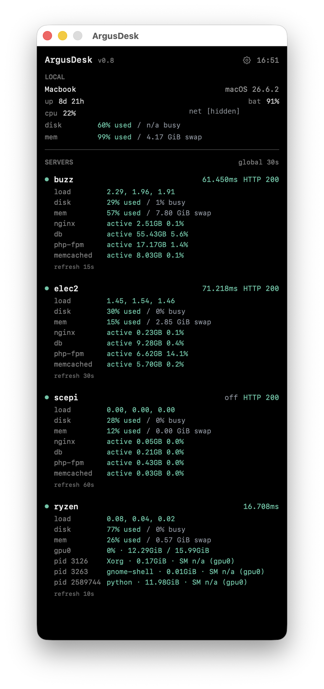

# ArgusDesk for macOS

ArgusDesk is a compact native macOS dashboard for your Mac and remote Linux
servers. It monitors servers through existing SSH keys and read-only commands,
with no server-side agent or stored SSH password.

Keep the dashboard open, hide it, or close its window: monitoring continues in
the background until you choose Quit. Native macOS notifications can alert you
when individual metrics cross their configured limits.

<p align="center">
  
</p>

## Features

- Local hostname or friendly label, macOS version, uptime, battery, CPU,
  network, disk capacity, memory usage, and allocated swap.
- Remote SSH connectivity, ping, HTTP status, load average, disk capacity and
  activity, memory, and swap.
- nginx, MariaDB, PHP-FPM, and Memcached status, RAM usage, and CPU usage.
- Optional NVIDIA GPU utilization, VRAM occupancy, and GPU process names,
  PIDs, memory allocations, and supported utilization readings.
- Different enabled checks and refresh intervals for each server.
- Friendly local/server labels with hostname or IP fallback.
- Black dashboard with saved vertical or horizontal server layouts, plus a
  menu bar health summary and manual refresh.
- Configurable warning and critical thresholds, optional recovery alerts,
  launch at login, and hidden startup.

See the [changelog](CHANGELOG.md) for release history and unreleased changes.

## Requirements

- macOS 14 or later; packaged universal builds support Apple silicon and Intel.
- Existing key-based SSH access to each monitored server.
- Standard Linux utilities for the enabled checks: `/proc`, `systemctl`, `awk`,
  `df`, and `free`. Root-device activity also uses `findmnt` and sysfs.
- `nvidia-smi` on servers with NVIDIA GPU checks enabled.
- Xcode with a Swift 6 toolchain when building from source.

## Installation

For packaged releases, download the DMG from [GitHub Releases](https://github.com/oxy86/argusdesk-macos/releases),
open it, and drag ArgusDesk to Applications.

On first launch, configure your servers:

1. Download [servers.example.json](https://raw.githubusercontent.com/oxy86/argusdesk-macos/main/servers.example.json)
   and save it as `servers.json` in a permanent location of your choice.
2. Edit the file with your own server addresses, SSH users, ports, and enabled
   checks. Verify key-based SSH access from Terminal first.
3. Open ArgusDesk Settings (Preferences), choose the file under
   **Configuration → Config file**, and click **Apply**.

The DMG contains the app only; it does not include a personal configuration or
create one automatically. Until a configuration is selected, the remote server
list is empty. ArgusDesk remembers the selected file's path and reads it again
on subsequent launches; it does not copy the file elsewhere.

To build an app bundle from source:

```bash
git clone https://github.com/oxy86/argusdesk-macos.git
cd argusdesk-macos
cp servers.example.json servers.json

# Edit servers.json with your own server details before launching.
./build_app.sh
open build/ArgusDesk.app
```

Use `./build_app.sh release universal` for an optimized Apple silicon/Intel
bundle. Source-built bundles use an ad-hoc development signature.

For development, `swift run ArgusDesk` also works. Keep its terminal open;
notifications and launch at login require the app bundle.

Before enabling launch at login, keep the app at a stable installation path.
For upgrades, quit ArgusDesk before replacing the app. Your preferences and
selected configuration file remain local and survive app replacement.

## Configuration

Start with [servers.example.json](servers.example.json), replace the generic
values, and select the resulting file in Preferences. The selected path is
remembered across launches. A project-local `servers.json` is ignored by Git;
keep private configuration out of the repository.

```json
{
  "remote_refresh_seconds": 60,
  "local_refresh_seconds": 5,
  "local_label": "My Mac",
  "servers": [
    {
      "label": "Example server",
      "host": "example.com",
      "ssh_user": "username",
      "ssh_port": 22,
      "refresh_seconds": null,
      "http_url": "https://example.com",
      "http_user_agent": "ArgusDesk/0.8",
      "enabled_checks": [
        "ssh",
        "ping",
        "http",
        "load",
        "disk",
        "memory",
        "nginx",
        "mariadb",
        "php_fpm",
        "memcached"
      ]
    }
  ]
}
```

`label` is optional on each server; missing or blank labels display the host.
The optional top-level `local_label` names your Mac and can also be edited in
Preferences. Leaving it blank restores the Mac hostname.

The default refresh intervals are 60 seconds remotely and 5 seconds locally.
Global values saved in Preferences override these JSON defaults. Each server's
optional `refresh_seconds` overrides the global remote interval: use a positive
whole number, or leave it missing, null, or blank to follow the global setting.
Per-server fields in Preferences save to the selected JSON file when you Apply.
Connections refresh independently; slow checks do not overlap or build a queue.

The SSH port defaults to 22. Set `ssh_user` explicitly and verify that ordinary
SSH works with your key, including any initial host-key confirmation, before
using the app. HTTP checks are optional; `http_user_agent` uses curl's default
when omitted.

Supported `enabled_checks` identifiers are `ssh`, `ping`, `http`, `load`, `disk`,
`memory`, `nginx`, `mariadb`, `php_fpm`, `memcached`, and `gpu`. Omit checks that
do not apply to a server. Disabled ping displays gray `off` and does not affect
health; disabled service rows are hidden.

For an NVIDIA compute server without web services, for example, use:

```json
"enabled_checks": ["ssh", "ping", "load", "disk", "memory", "gpu"]
```

## Reading the Dashboard

The dot in each server heading indicates SSH connectivity. Ping and HTTP
results have their own health colors. Metric rows flag individual warnings or
errors, while the menu bar summarizes overall server health.

Resource rows show:

```text
disk       29% used / 4% busy
mem        57% used / 1.20 GiB swap
```

Disk busy time is sampled for the remote root block device, rather than all
disks combined. Local macOS disk busy currently displays `n/a`; unsupported
remote filesystems do too. Swap shows allocated space, including zero when no
swap is used. Disk activity and swap are informational; capacity and RAM usage
have alert thresholds.

Service rows show state, RAM, and CPU. CPU is normalized to the server's total
logical CPU capacity, from 0–100%. One fully busy core on a twelve-core server
is approximately 8.3%. CPU samples and load averages cover different periods
and measure different things, so their values need not rise together.

GPU rows show utilization and used/total VRAM. Process rows identify the
executable, PID, memory allocation, and SM (compute) utilization when the driver
supports it. Unsupported readings display `n/a`. Allocated VRAM does not imply
that a process is actively computing.

## Preferences and Notifications

Choose the server layout, set refresh intervals and labels, adjust thresholds,
and enable alerts in Preferences. Click Apply to save edited refresh and alert
settings; layout and startup controls apply immediately.

Default warning and critical limits are:

| Metric | Warning | Critical |
| --- | ---: | ---: |
| Ping latency | 200 ms | 1000 ms |
| Disk capacity / RAM usage | 80% | 90% |
| PHP-FPM CPU | 50% | 90% |
| Other monitored service CPU | 10% | 25% |
| GPU utilization | 80% | 95% |
| GPU memory / VRAM occupancy | 80% | 95% |

Warning limits must be lower than critical limits. High GPU utilization is
normal during local-model generation; tune those limits to your workload.

Enable warning/error alerts, click Apply, and allow notifications when macOS
asks. Alerts identify the server and metric, include the measured value and
applicable threshold, and suppress unchanged warnings. Recovery alerts are
optional. The first unhealthy sample can also alert.

**Send test notification** requests permission independently and shows status
or an error in Preferences. A shortcut opens macOS Notification Settings.
Banners and sounds follow your macOS notification and Focus settings.

Enable **Launch at login** to start at sign-in, and optionally **Start with
dashboard hidden**. Closing or hiding the window leaves monitoring running;
Quit stops it. Monitoring pauses while the Mac sleeps.

## Development and Releases

Run `swift test` for regression coverage. The
[release workflow](.github/workflows/build-release.yml) tests and builds a
universal app and DMG. Manual runs produce development artifacts without
publishing; optional signed previews also validate signing and notarization.
Version-tag releases require matching app metadata, finalized
release notes, Developer ID signing, and successful notarization before upload.
See the [Developer Guide](README_DEVELOPER.md) for local packaging commands and
required GitHub Actions secrets.

## Security

- Remote commands are read-only and use key-only, noninteractive SSH with
  connection and execution timeouts.
- HTTP checks run locally through the system curl executable.
- Private hosts, usernames, configuration, and signing credentials remain
  outside public examples and release disk images.
- ArgusDesk does not install an agent on monitored servers or store SSH passwords.

## Documentation

- [Developer Guide](README_DEVELOPER.md)
- [Roadmap](ROADMAP.md)
- [Changelog](CHANGELOG.md)

## License

ArgusDesk is available under the [MIT License](LICENSE).
